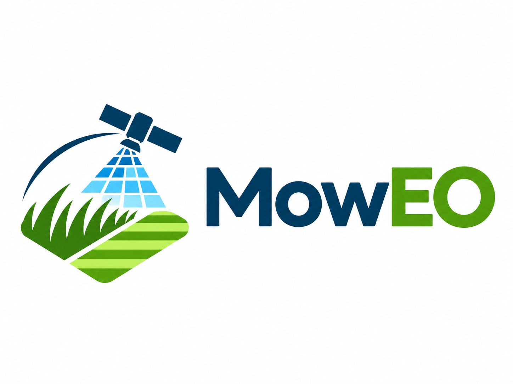
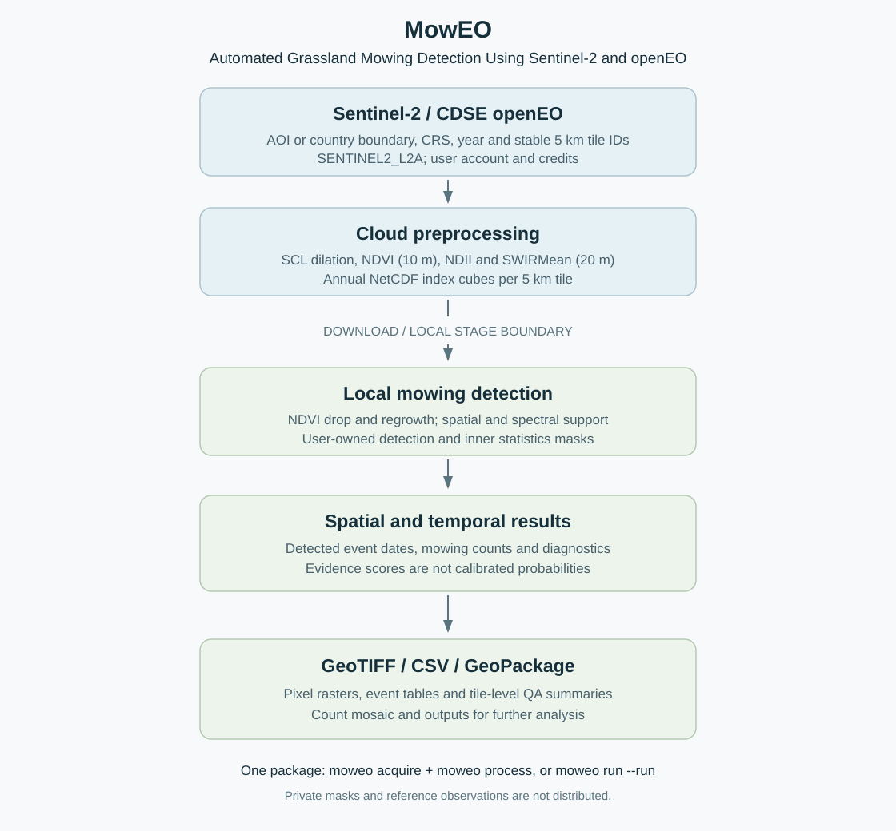

# MowEO – Automated Grassland Mowing Detection Using Sentinel-2 and openEO

<p align="center">
  
</p>

MowEO connects area selection, 5 km tiling, cloud preprocessing, annual NetCDF
acquisition, local grassland mowing detection, quality assessment and geospatial
export in one Python package. Version **0.2.0a2** is a prerelease.
License selection is pending; see [LICENSE_NOTICE.md](LICENSE_NOTICE.md).



## Installation

Install Miniconda or Anaconda, extract the repository and open a terminal in
the directory containing `pyproject.toml`. On Windows, use Anaconda Prompt.

```sh
conda env create -f environment.yml
conda activate moweo
python -m pip install --no-deps .
moweo --version
```

Activate `moweo` in each new terminal. The first command downloads Python 3.11
and dependencies; the pip command installs MowEO and its command-line interface.
Alternatively, activate a Python 3.11 virtual environment and run
`python -m pip install .`. Dependencies are also listed in `requirements.txt`.
openEO is pinned to 0.52.0; other dependencies use version ranges, not a fully
locked environment. See testing below for the environment actually verified.

## CDSE account and credits

Create and verify your [CDSE account](https://dataspace.copernicus.eu/).
Check your openEO credit balance in the Algorithm Plaza Billing page before
submission. Acquisition uses cloud processing credits; local detection does
not. CDSE currently advertises 10,000 free monthly credits, but quotas and terms
can change. Start with a small pilot before submitting a whole country.

- [CDSE openEO service](https://dataspace.copernicus.eu/ecosystem/services/openeo)
- [Quotas and limitations](https://documentation.dataspace.copernicus.eu/Quotas.html)

These service references were checked on 2026-11-12. Registration does not
guarantee enough credits for an entire region or year.

## Quick start: AOI first, grasslands later

Supply a valid polygon AOI with a declared CRS. Use absolute input paths in
these examples. Choose a suitable projected CRS in metres; EPSG:32633 is an
example for the original study area, not a global default.

```sh
moweo --project my_project init-aoi --aoi /absolute/path/aoi.gpkg --epsg 32633 --year 2026 --limit 10
moweo --project my_project prepare
moweo --project my_project acquire
```

`init-aoi --limit 10` selects at most ten tiles for **both acquisition and
processing**. Omit it to use the whole AOI. The last command is a dry run;
it submits no remote jobs. To start acquisition:

```sh
moweo --project my_project acquire --run --parallel 2
```

Open the displayed device-login link, authenticate with the intended CDSE
account and confirm with `YES`. No grassland mask is needed for acquisition.
After downloading, add private polygons containing only grassland features:

```sh
moweo --project my_project masks --grasslands /absolute/path/grasslands.gpkg
moweo --project my_project validate --require-stats
moweo --project my_project process --workers 4
```

Masks are rasterized on the fixed grid without changing tile IDs. They are not
distributed with the code. See the [input specification](data/README.md).

### Countries and tile IDs

Select a country from a supplied boundary dataset:

```sh
moweo --project country_project init-aoi --aoi /absolute/path/countries.gpkg --country Slovenia --country-field NAME --epsg 32633 --year 2026
```

Use the column and country name/code in your dataset. MowEO does not download
a boundary from a country name alone. Border tiles remain full squares;
subsequent masks exclude pixels outside the AOI. IDs such as
`eo_32633_380000_5090000` encode EPSG, west and south coordinates and remain
stable across years in the same grid. See [AOI and countries](docs/aoi_workflow.md).

### Alternative inputs and connected execution

To create the grid and masks together from grasslands, use a fresh project:

```sh
moweo --project grassland_project init --grasslands /absolute/path/grasslands.gpkg --epsg 32633 --year 2026
moweo --project grassland_project prepare
```

For existing grids and aligned per-tile masks, use `moweo --project my_project setup`
and follow the input specification. Once the project and both masks are ready,
connect acquisition and local processing:

```sh
moweo --project my_project run --run --parallel 2 --workers 4
```

The first `run` selects the workflow; `--run` enables remote submission.
Without `--run`, no jobs are submitted. Account confirmation still applies.
Use the separate stages when adding masks after acquisition. Installed wheels
use `moweo` or `python -m moweo`; numbered scripts and `.bat` files are legacy
shortcuts for source checkouts.

## Data and parameters

The collection is `SENTINEL2_L2A` on
`https://openeo.dataspace.copernicus.eu`; arbitrary collection switching is not
implemented. Cloud preprocessing applies SCL dilation masking and computes
NDVI from B04/B08 at 10 m, NDII from B8A/B11 at 20 m and SWIRMean from B11/B12
at 20 m. NetCDF downloads are **cloud-masked index cubes**, not raw Sentinel-2
SAFE products or reflectance-band archives.

Local detection identifies NDVI drops and regrowth. Spatial support and
NDII/SWIR responses provide diagnostic evidence, not calibrated probabilities.
The +5 m detection mask includes boundary pixels; the -7.5 m inner mask reduces
boundary mixing in statistics and must be a same-grid subset. Both manifests
are required for the full local pipeline, including empty-tile entries.

Settings are in local `project_config.json`. Defaults, fixed assumptions and
cloud settings are described in [parameters](docs/parameters.md) and
[project_config.example.json](project_config.example.json). Acquisition defaults
to March 15–October 31 and detection to April 1–October 31. Review these windows
for your region and the backend's temporal endpoint convention.

## Outputs

```text
my_project/workspace/<YEAR>/
  acquisition/
    openeo_jobs_<YEAR>.csv
    process_eopatch/<PATCH_ID>/
      <PATCH_ID>_NDVI_<YEAR>.nc
      <PATCH_ID>_NDII_SWIRMean_explicit20m_<YEAR>.nc
  processing/
    process_eopatch/<PATCH_ID>/       # baseline, final, diagnostics and event tables
    national_qa_<YEAR>.csv
    national_analysis_<YEAR>/        # summary tables and figures
    national_maps/
      AREA_MOWING_COUNT_<YEAR>_detection_plus5m.tif
      AREA_TILE_QA_<YEAR>.gpkg
  provenance/                       # settings, versions and process graphs
```

The count mosaic uses `0` for grass pixels with no detected mowing, `1–6` for
detected counts and `255` for NoData. Per-tile float rasters use `-9999` as
NoData; band descriptions identify counts, day-of-year dates and diagnostics.
GeoPackage output contains tile-level QA summaries, not vectorized mowing
pixels or field boundaries. `output_prefix` controls the `AREA` prefix.

## Progress and resuming

```sh
moweo --project my_project status
moweo --project my_project process --workers 1
moweo --project my_project process --dry-run
```

Use fewer workers when RAM or storage becomes a bottleneck. Keep the computer
awake during download and processing. Repeat acquisition to resume completed
products and logged jobs. Interrupting the client does not cancel remote jobs.
Do not run concurrent acquisition clients against the same workspace.

For another year on the same grid, change `year` in the configuration and
repeat acquisition and processing. Outputs are separated by year; review
whether the mask vintage is appropriate. Changing area, CRS, seasonal windows
or cloud processing requires a fresh workspace: existing products/jobs are
reused by tile and product, not a complete parameter fingerprint. Never change
settings during an active run. Relative input paths refer to the project folder.

## Testing and reproducibility

```sh
python -m unittest discover -s tests -v
```

The tests create synthetic inputs and need no CDSE account or credits. They
cover AOI/country grids, stable IDs, persistent tile limits, later mask addition,
dry-run acquisition, detection, reports, GeoTIFF/CSV/GeoPackage outputs and
rejection of incomplete mosaics. Temporary examples are removed afterward.
This verifies software behavior, not scientific detection accuracy.

Both tests passed on Windows/Python 3.13.5 from source and an installed wheel.
The documented Python 3.11 Conda environment has not been executed here; CI
targets Python 3.11 on Windows and Linux but has not yet run on GitHub.
macOS has not been tested. See [release notes](RELEASE_NOTES.md) for versions.

The CLI records settings, versions, backend and collection in `provenance/`.
Actual openEO process graphs are saved before remote submission. Preserve these
records and input vintages; backend/archive changes can still prevent exact
reproduction. Tokens remain in the private `workspace/<YEAR>/.openeo_auth/`.

## Limitations and release status

Thresholds were calibrated for the source study, not validated worldwide.
Clouds, drought, grazing, senescence and observation gaps can affect detections.
Zero detected events does not establish no mowing. Dates are time-series
estimates, not exact observed operation times. Extensive countries require a
suitable projection, sufficient credits and independent regional validation.

No project masks, reference observations, credentials, cubes or results are
included. Public upload, license assignment, author/citation metadata and DOI
archival remain separate release tasks. See [release status](docs/release_status.md).

## Documentation

- [Architecture](docs/architecture.md)
- [AOI and country workflow](docs/aoi_workflow.md)
- [Grassland input specification](data/README.md)
- [Parameters](docs/parameters.md)
- [Release notes](RELEASE_NOTES.md)
- [Planned explanatory figures](docs/figures/README.md)
