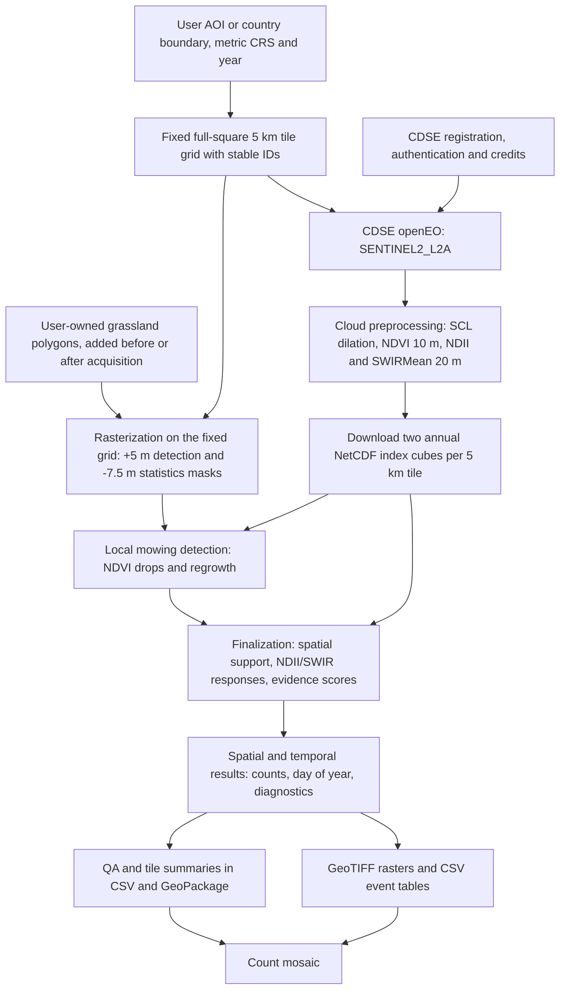

# MowEO architecture

The two execution stages are connected by persistent NetCDF files. They may be
run separately (`moweo acquire`, `moweo process`) or sequentially (`moweo run
--run`). Acquisition computes indices in the cloud; local detection does not
spend openEO credits. A grassland mask is an external input, not an output of
the mowing detector. Neither project masks nor reference observations ship
with the package.

| Responsibility | Python module |
|---|---|
| User inputs and private masks | `moweo.inputs`, `moweo.config` |
| AOI/country grid and later mask preparation | `moweo.area`, `moweo.masks` |
| Tile preparation | `moweo.acquisition_prepare` |
| CDSE login and annual acquisition | `moweo.auth`, `moweo.acquisition` |
| Core time-series and spectral computations | `moweo.core` |
| Mask validation and patch detection | `moweo.processing_prepare`, `moweo.detection` |
| Final products and QA | `moweo.finalization`, `moweo.analysis` |
| GeoTIFF mosaic and tile GeoPackage | `moweo.export`, `moweo.vector_export` |
| Local orchestration and workers | `moweo.pipeline`, `moweo.parallel` |
| Connected workflow and provenance | `moweo.cli`, `moweo.provenance` |

No calibrated probability of correctness is produced. Evidence scores combine
signal and spectral/spatial support; they must be described as evidence scores,
not validated probabilities. Event dates are inferred from sampled time series,
not exact observed times of farm operations. GeoPackage output represents tile
summaries, while mowing counts/dates remain pixel-level raster and CSV products.
